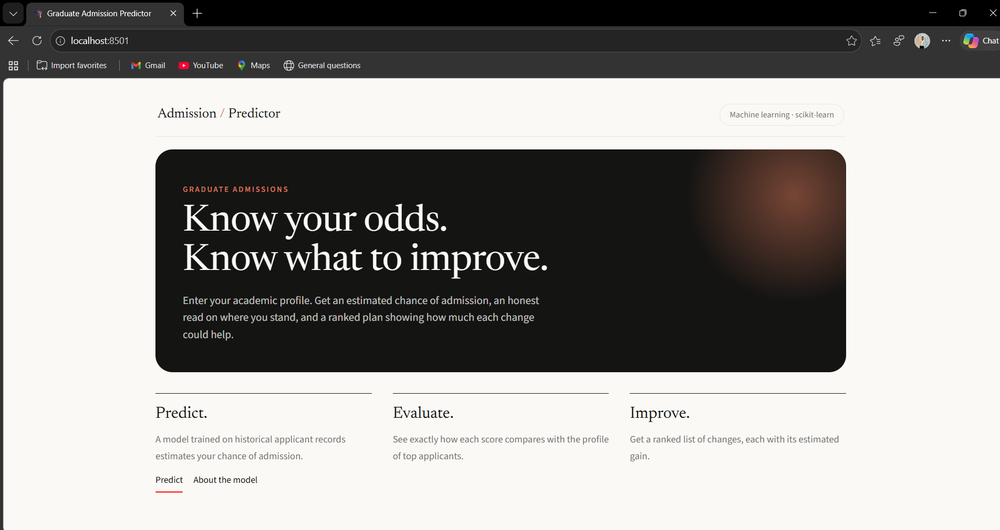
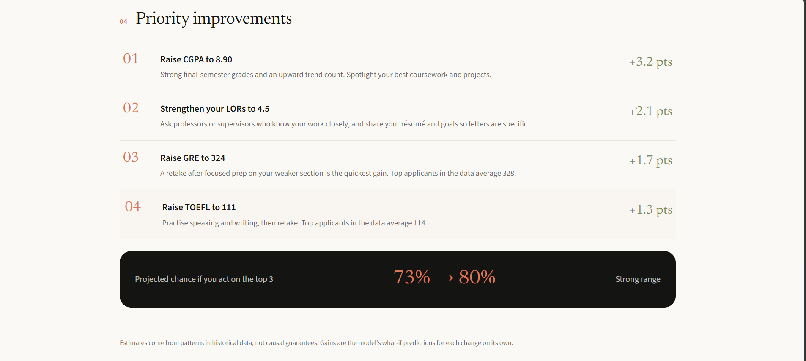
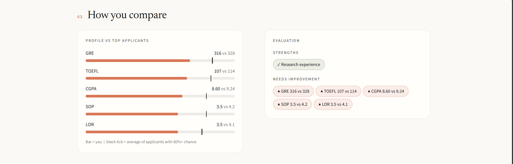
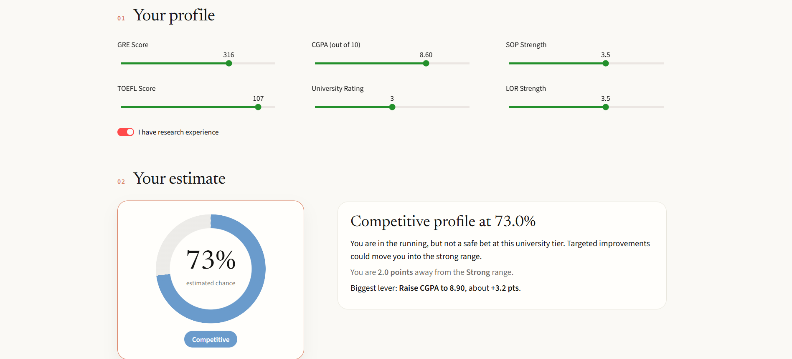

 <div align="center">

# 🎓 Graduate Admission Predictor

**Enter your profile. Get your odds. See exactly what to improve first.**

An ML-powered web application that estimates a student's chance of graduate admission and identifies the profile improvements that could increase the predicted probability.

<br>


[**📂 Source Code**](https://github.com/Adeshkachare/graduate-admission-predictor) · [**🐞 Report a Bug**](https://github.com/Adeshkachare/graduate-admission-predictor/issues)

</div>

---

## 📸 Application Preview

<div align="center">

### 1. Landing Page



### 2. Admission Probability Estimate



### 3. Profile Comparison & Improvement Recommendations



### 4. Machine Learning Model Comparison



</div>

---

## ✨ Features

| Feature | Description |
|---|---|
| 🎯 **Admission Probability** | Estimates admission chances and assigns a tier: Excellent, Strong, Competitive, Reach, or Long Shot. |
| 📊 **Peer Comparison** | Compares a student's profile with applicants predicted to have an 80% or higher admission chance. |
| 💡 **Priority Improvements** | Evaluates what-if changes to GRE, TOEFL, CGPA, SOP, LOR, and research inputs. |
| 📈 **Projected Outcome** | Shows predicted admission chances before and after applying the top three suggested improvements. |
| 🔬 **Model Transparency** | Presents model comparison results and permutation feature importance. |
| 🎨 **Interactive Interface** | Uses Streamlit with custom HTML/CSS, an animated gauge, and visual comparison elements. |

---

## 🧠 How It Works

The application uses a machine learning pipeline to prepare the dataset, compare regression models, select the best-performing model using cross-validation, and generate admission predictions.

```text
Admission_Predict.csv
        |
        v
Data Cleaning and Preparation
        |
        v
Train and Evaluate Four Models
(5-Fold Cross-Validation)
        |
        v
Select Model Using CV R²
        |
        v
Refit Selected Model on All Data
        |
        v
Save model.pkl and metrics.json
        |
        v
Streamlit Application (app.py)
        |
        v
Admission Estimates and What-If Analysis
```

### Model Performance

Models were evaluated using an 80/20 train-test split and five-fold cross-validation. The deployed model was selected using cross-validated R².

| Model | CV R² | Test R² | Test MAE |
|---|:---:|:---:|:---:|
| Linear Regression | 0.781 | 0.821 | 0.048 |
| Ridge Regression | 0.781 | 0.820 | 0.048 |
| **Lasso Regression (Deployed)** | **0.781** | **0.817** | **0.049** |
| Random Forest | 0.734 | 0.806 | 0.050 |

**Key observation:** The three linear models perform similarly and outperform Random Forest on this relatively small dataset. Greater model complexity does not necessarily translate into better predictive performance.

---

## 🛠️ Tech Stack

- **Programming Language:** Python
- **Machine Learning:** scikit-learn
- **Regression Algorithms:** Linear Regression, Ridge, Lasso, Random Forest
- **Data Processing:** pandas, NumPy
- **Model Serialization:** joblib
- **Web Framework:** Streamlit
- **Frontend Styling:** Custom HTML/CSS
- **Development Environment:** Python-compatible IDE or notebook environment

---

## 📁 Project Structure

```text
graduate-admission-predictor/
│
├── app.py                  # Streamlit application
├── train.py                # Model training and comparison
├── model.pkl               # Trained model and feature information
├── metrics.json            # Model evaluation results
├── Admission_Predict.csv   # Dataset
├── requirements.txt        # Python dependencies
│
├── assets/
│   ├── screenshot_1.png    # Landing page
│   ├── screenshot_2.png    # Admission estimate
│   ├── screenshot_3.png    # Profile comparison
│   └── screenshot_4.png    # Model comparison
│
├── LICENSE
└── README.md
```

---

## 🚀 Run Locally

Follow these steps to run the application on your computer.

### 1. Clone the repository

```bash
git clone https://github.com/Adeshkachare/graduate-admission-predictor.git
cd graduate-admission-predictor
```

### 2. Create a virtual environment

```bash
python -m venv venv
```

Activate it on Windows:

```bash
venv\Scripts\activate
```

On macOS or Linux:

```bash
source venv/bin/activate
```

### 3. Install dependencies

```bash
pip install -r requirements.txt
```

### 4. Retrain the model (optional)

```bash
python train.py
```

Run this step if you want to regenerate the model and evaluation results.

### 5. Launch the application

```bash
streamlit run app.py
```

Open the URL displayed in your terminal, usually:

```text
http://localhost:8501
```

---

## ☁️ Deployment

The application can be deployed using [Streamlit Community Cloud](https://share.streamlit.io/).

1. Push the project to GitHub.
2. Sign in to Streamlit Community Cloud using your GitHub account.
3. Create a new app and select this repository.
4. Set `app.py` as the application entry point.
5. Deploy the application.

Ensure that the required dependencies and model artifacts are available to the deployed application.

---

## 📚 Dataset

The project uses the public Graduate Admissions dataset containing 500 records.

### Input Features

- GRE Score
- TOEFL Score
- University Rating
- Statement of Purpose (SOP)
- Letter of Recommendation (LOR)
- CGPA
- Research experience

### Target Variable

- **Chance of Admit:** The dataset's target variable, representing the admission probability value recorded in the data.

---

## ⚠️ Limitations

- Predictions reflect patterns learned from historical data and are not guarantees of actual admission outcomes.
- The dataset contains only 500 records, which limits its representativeness.
- What-if improvements are model-generated estimates, not proof that changing an individual factor will cause admission chances to increase.
- Actual admissions depend on additional factors, including university-specific criteria, research fit, application quality, available seats, and competition.
- This project is intended for educational and demonstration purposes, not as a substitute for official admissions guidance.

---

## 🔮 Future Improvements

- [ ] Add work experience and publication-related features.
- [ ] Experiment with gradient boosting and systematic hyperparameter tuning.
- [ ] Investigate prediction uncertainty and confidence intervals.
- [ ] Support comparisons across multiple target universities.
- [ ] Expand the dataset to improve generalizability.
- [ ] Evaluate performance on additional unseen data.

---

## 👤 Author

**Adesh Kachare**

- GitHub: [Adeshkachare](https://github.com/Adeshkachare)
- LinkedIn: [Connect with me]([[https://www.linkedin.com/in/adesh-k-b90a6a275/?lipi=urn%3Ali%3Apage%3Ad_flagship3_profile_view_base_contact_details%3BwSx5iC62TvaZww6q8h5hHQ%3D%3D])

If you find this project useful, consider giving the repository a ⭐ on GitHub.

---

<div align="center">

<sub>Released under the MIT License.</sub>

</div>
